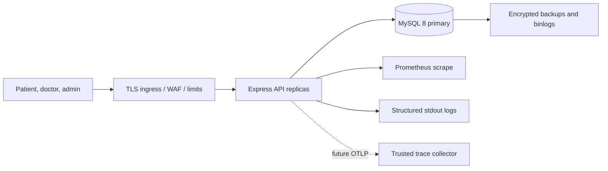
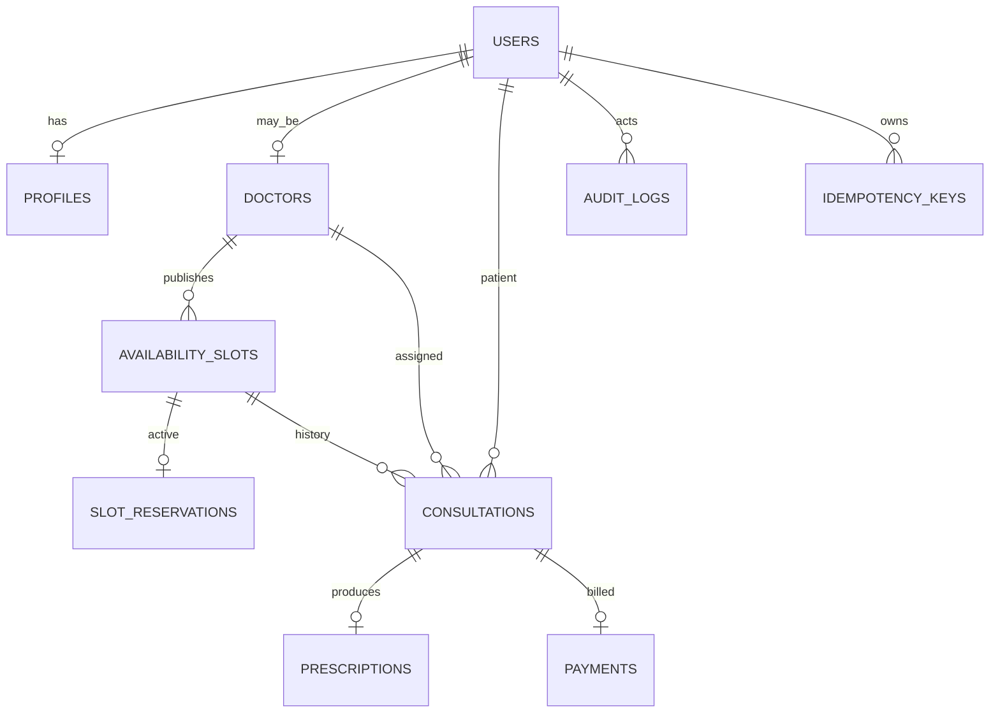

# Architecture and Operations

## Overview

The initial deployment is a modular monolith: stateless Express replicas and a MySQL 8 primary. Modules own routes, validation, services, and Sequelize models. Services share explicit database transactions; controllers do not call one another. Background workers and provider adapters can be separate deployables when introduced, without changing the initial MySQL source of truth.



The API is stateless and horizontally scalable. MySQL is authoritative. Do not cache authorization, prescriptions, or consultation data. Doctor search may use a short-lived cache after load measurement. Availability is never a lock: booking checks the primary inside a transaction.

## Booking sequence

```mermaid
sequenceDiagram
  actor P as Patient
  participant A as Express API
  participant DB as MySQL
  P->>A: POST consultation + Idempotency-Key
  A->>DB: BEGIN; insert user/key and request hash
  A->>DB: SELECT availability slot FOR UPDATE
  A->>DB: verify OPEN, future, doctor verified
  A->>DB: INSERT consultation and unique active reservation
  A->>DB: mark slot BOOKED; store replay response and audit event
  A->>DB: COMMIT
  A-->>P: 201 consultation
  Note over P,DB: Same key/hash replays; same key/different hash returns 409
  Note over DB: UNIQUE slot_reservations.slot_id prevents double booking
```

Cancellation locks consultation and slot, changes consultation to `CANCELLED`, removes the active reservation, reopens the future slot, and writes the audit event in the same transaction. History is retained. A unique reservation row can be removed, unlike a permanent unique key on historical consultation rows.

## Entity relationships



## Transactions, retry, and async work

Booking uses an InnoDB `READ COMMITTED` transaction, a slot row lock, unique active reservation, user-scoped idempotency row, and transactional audit. Retrying is limited to transient connection/deadlock errors, bounded exponential backoff with jitter, and idempotent calls reusing the original key. Never retry authorization, validation, or state errors. Deadlock retries are not yet implemented in the request service; the caller can safely retry with the same key after a transient failure.

Consultation transitions and prescription creation lock their consultation row and enforce state and doctor ownership. External payment capture, notifications, and video-room setup must not happen inside database transactions. When those providers are added, write an outbox command in the same business transaction, process asynchronously with bounded retry and provider idempotency, and define compensations (release reservation/refund) for terminal failures. The current payments table is not a payment provider integration.

## Scale and performance

100,000 consultations/day averages approximately 1.16 writes/second; peak concentration, search traffic, and provider fan-out determine actual capacity. The p95 goals (<200 ms reads, <500 ms writes) require production-like load tests, realistic data, query plans, TLS/network latency, and provider timings. The source tree alone cannot demonstrate those targets.

Keep replicas stateless, set a total Sequelize pool budget across replicas, bound pagination, and monitor pool use, lock waits, and slow queries. Existing indexes cover doctor/status/date, patient/date, status/date, doctor specialization, slot lookup, and audit events. Analytics are indexed SQL aggregates; move them to replicas or scheduled rollups if they contend with booking. Leading-wildcard doctor name/specialization search will not scale indefinitely; measure and then consider MySQL full-text or a search service.

At 100k consultations/day, history grows about 36.5M rows/year. Apply approved retention/archive and deletion policies. MySQL partitioning is not a drop-in solution because partitioned InnoDB tables constrain foreign keys and unique keys; validate a concrete schema/query plan before partitioning or archive to separately keyed history tables. Redis is not used as a booking authority.

## Availability and DR

99.95% monthly availability allows about 22 minutes of downtime per 30-day month. It requires multi-zone API replicas, HA MySQL failover, headroom, deploy rollback, alerting, and drills; Docker Compose does not provide this. Liveness is independent from MySQL; readiness checks MySQL. Graceful shutdown closes HTTP then the Sequelize pool.

Recommended launch objectives (not yet demonstrated): RPO <= 5 minutes using encrypted backups plus binlogs/PITR, RTO <= 60 minutes with documented restore/failover. Encrypt backups, restrict restore roles, keep copies in a separate account/region where residency allows, and test restores quarterly. A DR drill validates secrets, migrations, consistency, and DNS/failover.

## Observability

Pino emits redacted JSON logs and request IDs. Prometheus exposes request totals and duration histograms plus process metrics; `/metrics` requires a bearer secret. Liveness/readiness probes are provided. Alert on 5xx rate, p95/p99 latency, DB pool saturation, deadlocks/lock waits, migration failures, audit write errors, backup age, and queue/outbox age once implemented. Do not put user identifiers, email, tokens, clinical content, or high-cardinality data in labels.

OpenTelemetry auto-instrumentation starts before Express is loaded when `OTEL_EXPORTER_OTLP_ENDPOINT` is set and exports OTLP/HTTP traces. Production configuration requires the endpoint; use a trusted collector, define sampling and retention, dashboards, and alerts before claiming end-to-end trace coverage. The included in-process rate limiter is per replica; production must enforce shared limits at the edge or use a distributed store.